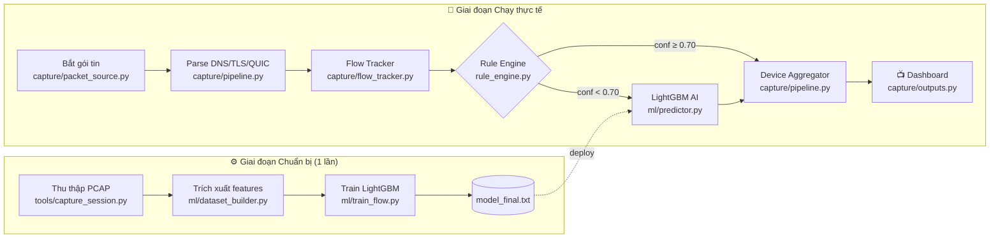
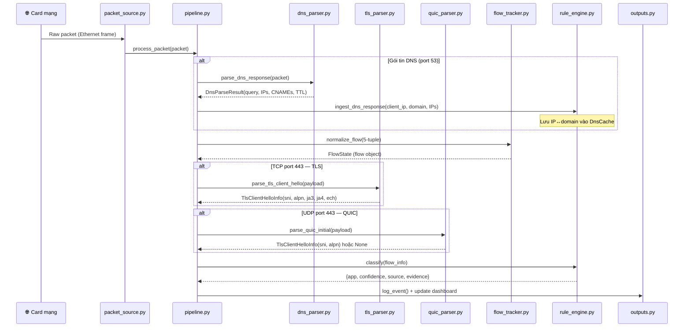

<div align="center">

# 🔍 Edge AI — Phân Loại Ứng Dụng Qua Lưu Lượng Mạng Mã Hóa

**Đồ án Tốt nghiệp Đại học**

[](https://python.org)
[](https://lightgbm.readthedocs.io)
[](LICENSE)

**Nhóm thực hiện:** Trần Văn Danh &nbsp;·&nbsp; Lê Nhựt Phương

</div>

---

## 1. Tổng quan

Project xây dựng hệ thống **Edge AI** chạy trực tiếp trên Raspberry Pi hoặc Laptop trong mạng LAN, có khả năng **nhận biết ứng dụng nào đang chạy trên từng thiết bị**, chỉ bằng cách phân tích **metadata gói tin** — không giải mã nội dung.

**Vấn đề:** Hơn 90% traffic Internet ngày nay dùng **TLS 1.3** hoặc **QUIC** — nội dung bị mã hóa hoàn toàn. Các công cụ DPI (Deep Packet Inspection) truyền thống không còn hoạt động được.

**Giải pháp:** Thay vì đọc nội dung, hệ thống phân tích **cách gói tin chạy** (kích thước, thời gian, hướng, metadata TLS) kết hợp AI để suy ra ứng dụng.

**Kết quả hiển thị:**
```
┌─────────────────┬────────────────┬─────────────┬──────┬────────┐
│ MAC             │ IP             │ App         │ Conf │ Source │
├─────────────────┼────────────────┼─────────────┼──────┼────────┤
│ d0:39:57:89:... │ 192.168.1.15   │ youtube     │ 0.97 │ sni    │
│ aa:bb:cc:dd:... │ 192.168.1.20   │ spotify     │ 0.99 │ sni    │
│ 11:22:33:44:... │ 192.168.1.25   │ chatgpt     │ 0.95 │ sni    │
└─────────────────┴────────────────┴─────────────┴──────┴────────┘
```

**Công nghệ:** Python 3.9+, Scapy, LightGBM, Rich, cryptography, PyYAML, tcpdump.

---

## 2. Kiến trúc & Sơ đồ luồng tổng thể

### Hai giai đoạn của hệ thống



### Luồng xử lý từng gói tin



---

## 3. Luồng chạy chi tiết từng bước

### LUỒNG A — Giai đoạn Chuẩn bị (làm 1 lần)

#### Bước A1: Thu thập traffic thực tế
- **File:** `tools/capture_session.py`
- **Lệnh:** `sudo python3 tools/capture_session.py --batch batch1 --iface wlp61s0 --dur 30 --apps youtube`
- **Làm gì:** Chạy `tcpdump` ngầm, hiển thị hướng dẫn, tự động ghi nhãn thời gian START/END từng app
- **Output:**
  - `captures/batch1/capture_batch1_YYYYMMDD_HHMMSS.pcap` — raw packets
  - `captures/batch1/labels_batch1_*.jsonl` — nhãn thời gian mỗi app
  - `captures/batch1/session_batch1_*.json` — metadata session
- **Dấu hiệu thành công:** File PCAP > 50MB/app (30 phút)

#### Bước A2: Trích xuất đặc trưng (Feature Extraction)
- **File:** `ml/dataset_builder.py` → gọi `ml/features.py` (class `WindowStats`)
- **Làm gì:** Đọc PCAP theo session, nhóm packet thành flow 5 giây, tính 24 con số thống kê
- **Output:** `ml/data/dataset_flow.csv`, `ml/data/dataset_device.csv`
- **Dấu hiệu thành công:** dataset_flow.csv có ≥ 500 dòng/app

#### Bước A3: Huấn luyện mô hình
- **File:** `ml/train_flow.py`, `ml/train_device.py`
- **Làm gì:** LOSO Cross Validation 5 fold, train LightGBM, lưu model và calibration
- **Output:** `ml/models/flow/model_final.txt`, `ml/models/flow/cv_summary.json`

#### Bước A4: Đánh giá
- **File:** `ml/evaluate.py`
- **Output:** `ml/results/report.html`, confusion matrix PNG, F1 per-class PNG

---

### LUỒNG B — Giai đoạn Chạy thực tế

#### Bước B1: Khởi động hệ thống
- **File:** `capture/main.py` — hàm `cmd_live()` hoặc `cmd_offline()`
- **Làm gì:** Đọc `config.yaml`, nạp `rules.yaml` vào `RuleEngine`, khởi tạo `CapturePipeline`, `RichDashboard`, `JsonlLogger`

#### Bước B2: Bắt gói tin
- **File:** `capture/packet_source.py`
  - `LiveSource`: Dùng Scapy `sniff()` với BPF filter `"tcp or udp"`
  - `PcapSource`: Đọc file `.pcap` với `rdpcap()`
- **Output:** Từng packet Scapy → gọi `pipeline.process_packet(packet)`

#### Bước B3: Lọc và phân tích layer
- **File:** `capture/pipeline.py` — hàm `process_packet()`
- **Thứ tự xử lý:**
  1. Trích xuất MAC (Ethernet), IP nguồn/đích (IPv4/IPv6), timestamp
  2. Lọc bỏ packet không phải TCP/UDP
  3. Lọc bỏ packet không liên quan LAN subnet
  4. Học MAC→IP mapping của thiết bị LAN vào `DeviceRegistry`

#### Bước B4: Xử lý DNS (nếu là gói DNS)
- **File:** `capture/parsers/dns_parser.py` — `parse_dns_response()`
- **Điều kiện:** `src_port == 53` hoặc `dst_port == 53`
- **Output:** Gọi `rule_engine.ingest_dns_response()` → lưu vào `DnsCache`
- **Giới hạn:** DNS over HTTPS (DoH) / DNS over TLS (DoT) không parse được

#### Bước B5: Chuẩn hóa hướng flow
- **File:** `capture/flow_tracker.py` — `normalize_flow()`
- **Làm gì:** Xác định hướng client→server từ 5-tuple, gom packet vào `FlowState`
- **Logic:** IP trong LAN subnet → là client; IP ngoài → là server

#### Bước B6: Parse TLS ClientHello (TCP port 443)
- **File:** `capture/parsers/tls_parser.py` — `parse_tls_client_hello()`
- **Điều kiện:** TCP, `first_n_packets ≤ 10`, chưa `inspected`
- **Trích xuất:** SNI (extension 0x0000), ALPN (0x0010), ECH (0xFE0D), JA3, JA4
- **JA3:** MD5 hash theo Salesforce spec, loại GREASE values per RFC 8701
- **JA4:** FoxIO spec, sort extension + cipher, ổn định hơn JA3
- **TCP Reassembly:** Buffer TCP segments để xử lý ClientHello lớn (Post-Quantum TLS)

#### Bước B7: Parse QUIC Initial (UDP port 443)
- **File:** `capture/parsers/quic_parser.py` — `parse_quic_initial()`
- **Làm gì:**
  1. Kiểm tra QUIC Long Header (`byte[0] & 0xC0 == 0xC0`)
  2. Xác định phiên bản QUIC (v1 RFC 9000 hay v2 RFC 9369)
  3. Derive Initial Secret bằng HKDF từ Connection ID và salt cố định trong RFC
  4. Giải mã header protection bằng AES-128-CTR
  5. Giải mã payload bằng AES-128-GCM
  6. Parse QUIC CRYPTO frame → TLS ClientHello → đọc SNI
- **Nếu thất bại:** Trả `None` → pipeline fallback sang DNS cache

#### Bước B8: Phân loại — Rule Engine (Tầng 1)
- **File:** `rule_engine.py` — `classify(flow_info)`
- **Input:** `{sni, alpn, ja3, ja4, ech, client_ip, dest_ip, dest_port, protocol}`

| Lớp | Nguồn | Confidence | Ghi chú |
|-----|-------|:----------:|---------|
| L1 SNI Group A | TLS/QUIC ClientHello | 0.95–0.97 | Domain độc quyền 1 app |
| L1 SNI Group B | TLS/QUIC ClientHello | 0.91–0.95 | Domain chính của app |
| L1 SNI Group B- | TLS/QUIC ClientHello | 0.60–0.85 | Domain chia sẻ |
| L1 SNI Group C | TLS/QUIC ClientHello | 0.10–0.30 | Hạ tầng chung |
| L2 DNS Cache | DNS response đã lưu | × 0.9 | IP từng được resolve |
| L3 JA3/JA4 | TLS fingerprint | ≤ 0.60 | Nhận diện client library |
| L4 Port/Protocol | dst_port, transport | Thấp | Không phân biệt được |
| L5 IP/ASN | IP range | ≤ 0.40 | Thuộc ASN Google/Meta |

- **Output:** `{app, confidence, source, matched_rule, evidence[]}`
- **Nếu `confidence < 0.5`:** trả về `app="unknown"`

#### Bước B9: Phân loại — LightGBM AI (Tầng 2) *(kế hoạch tích hợp)*
- **File:** `ml/predictor.py` — class `FlowPredictor`
- **Kích hoạt khi:** `confidence < 0.70` từ Rule Engine
- **Input:** 24 features từ `WindowStats.extract()`
- **Output:** `(app: str, confidence: float)` sau isotonic calibration

#### Bước B10: Tổng hợp theo thiết bị
- **File:** `capture/pipeline.py` — `get_device_summary()`
- **Làm gì:** Gom flow của cùng `client_ip`, vote theo bytes trong `device_active_window = 60s`
- **Output:** `{ip, mac, name, app, confidence, active_flows, bytes}`

#### Bước B11: Hiển thị dashboard
- **File:** `capture/outputs.py` — class `RichDashboard`
- **Cập nhật:** Mỗi `refresh_interval = 1.0s`
- **Log:** `traffic_events.jsonl` — mỗi dòng 1 sự kiện
- **Report:** `report.json` — thống kê tổng hợp sau khi kết thúc

---

## 4. Phân tích gói tin

### 4.1 Gói tin DNS Response

**Mục đích:** Xây dựng cache IP↔domain để Rule Engine dùng khi không thấy SNI.

| Trường | Giá trị ví dụ | Ý nghĩa |
|--------|--------------|---------|
| Src IP | `8.8.8.8` | DNS server |
| Dst IP | `192.168.1.15` | Máy trong LAN |
| Src Port | `53` | Luôn là 53 cho DNS response |
| QR bit | `1` | 1 = Response |
| QNAME | `googlevideo.com.` | Domain được hỏi |
| TYPE A | `142.250.190.46` | Địa chỉ IPv4 |
| CNAME | `r1---sn-xxx.googlevideo.com.` | Alias domain |
| TTL | `300` | Giây trước khi cache hết hạn |

**Wireshark filter:** `dns && dns.flags.response == 1`

**Dấu hiệu lỗi:** RCODE != 0, hoặc ANCOUNT = 0

---

### 4.2 Gói tin TLS ClientHello (TCP)

**Mục đích:** Trích xuất SNI, JA3/JA4 để Rule Engine phân loại.

| Trường | Giá trị ví dụ | Ý nghĩa |
|--------|--------------|---------|
| Dst Port | `443` | HTTPS |
| Record Type (byte[0]) | `0x16` | TLS Handshake |
| Handshake Type (byte[5]) | `0x01` | ClientHello |
| Extension 0x0000 | `www.youtube.com` | **SNI** ← quan trọng nhất |
| Extension 0x0010 | `h2`, `http/1.1` | **ALPN** |
| Extension 0xFE0D | (có bytes) | **ECH** — SNI bị mã hóa |

**Ví dụ cụ thể:**
```
TLS ClientHello
  Content Type: Handshake (0x16)
  Handshake Type: Client Hello (1)
  Extensions:
    server_name (0):     www.youtube.com    ← SNI
    alpn (16):           h2                 ← ALPN
    supported_versions:  TLS 1.3 (0x0304)
```

**Wireshark filter:** `tls.handshake.type == 1`

**Dấu hiệu ECH:** Extension 0xFE0D có mặt → SNI bị mã hóa → fallback DNS

---

### 4.3 Gói tin QUIC Initial

**Mục đích:** YouTube và nhiều app dùng QUIC thay TLS/TCP.

| Trường | Giá trị ví dụ | Ý nghĩa |
|--------|--------------|---------|
| Protocol | UDP | QUIC chạy trên UDP |
| Dst Port | `443` | QUIC HTTPS |
| byte[0] bit 7 | `1` | QUIC Long Header |
| byte[0] bits 4-5 | `00` | Initial packet |
| bytes[1-4] | `0x00000001` | QUIC v1 (RFC 9000) |

**Quy trình giải mã (trong `quic_parser.py`):**
```
1. Lấy DCID từ gói tin
2. Derive Initial Secret: HKDF(salt_v1, DCID)
3. Derive client_key, client_iv, hp_key
4. Remove header protection: AES-128-CTR(hp_key, sample)
5. Decrypt payload: AES-128-GCM(client_key, client_iv, payload)
6. Parse QUIC CRYPTO frame → TLS ClientHello → SNI
```

**Wireshark filter:** `quic && quic.long.packet_type == 0`

**Nếu parser thất bại:** Trả `None`, pipeline tự fallback sang DNS cache

---

### 4.4 Gói tin Data (sau handshake)

Payload bị mã hóa. Project **không** đọc nội dung. Chỉ dùng:

| Thuộc tính | Feature tính được |
|-----------|-----------------|
| `len(packet)` | `pkt_len_mean`, `bytes_total` |
| `packet.time` | `iat_mean`, `iat_std`, `iat_max` |
| Hướng (src IP trong LAN?) | `bytes_fwd`, `bytes_bwd`, `bytes_down_ratio` |
| dst_port | `dest_port` |
| Protocol | `is_tcp`, `is_udp` |

---

## 5. Bảng tóm tắt thứ tự gói tin

| # | Gói tin | Nguồn | Đích | Protocol | Mục đích |
|:-:|---------|-------|------|----------|---------|
| 1 | DNS Query | 192.168.1.x | 8.8.8.8 | UDP/53 | Máy hỏi domain |
| 2 | DNS Response | 8.8.8.8 | 192.168.1.x | UDP/53 | Lưu IP↔domain vào DnsCache |
| 3 | TCP SYN | 192.168.1.x | Server | TCP/443 | Bắt đầu kết nối |
| 4 | TCP SYN-ACK | Server | 192.168.1.x | TCP/443 | Server chấp nhận |
| 5 | TLS ClientHello | 192.168.1.x | Server | TCP/443 | ⭐ Trích xuất SNI, JA3/JA4 |
| 6 | TLS ServerHello | Server | 192.168.1.x | TCP/443 | Không dùng |
| 7+ | TLS Data | Cả hai chiều | Cả hai chiều | TCP/443 | Tính 24 features thống kê |
| — | QUIC Initial | 192.168.1.x | Server | UDP/443 | ⭐ Giải mã → SNI |
| — | QUIC Data | Cả hai chiều | Cả hai chiều | UDP/443 | Tính 24 features thống kê |

---

## 6. 24 Features ML (WindowStats — mỗi flow 5 giây)

| # | Feature | Đơn vị | Mô tả |
|:-:|---------|--------|-------|
| 1 | `n_pkts_total` | count | Tổng số gói tin |
| 2 | `bytes_total` | bytes | Tổng bytes cả 2 chiều |
| 3 | `n_pkts_fwd` | count | Số gói upload |
| 4 | `n_pkts_bwd` | count | Số gói download |
| 5 | `fwd_bwd_pkt_ratio` | ratio | n_fwd / n_bwd |
| 6 | `pkt_len_mean` | bytes | Kích thước gói trung bình |
| 7 | `pkt_len_std` | bytes | Độ lệch chuẩn kích thước gói |
| 8 | `pkt_len_min` | bytes | Gói nhỏ nhất |
| 9 | `pkt_len_max` | bytes | Gói lớn nhất |
| 10 | `pkt_len_fwd_mean` | bytes | Kích thước gói upload trung bình |
| 11 | `bytes_fwd` | bytes | Tổng bytes upload |
| 12 | `bytes_bwd` | bytes | Tổng bytes download |
| 13 | `bytes_ratio` | ratio | bytes_bwd / bytes_fwd |
| 14 | `iat_mean` | seconds | Inter-Arrival Time trung bình |
| 15 | `iat_std` | seconds | Độ lệch chuẩn IAT |
| 16 | `iat_max` | seconds | Khoảng cách gói lớn nhất |
| 17 | `iat_min` | seconds | Khoảng cách gói nhỏ nhất |
| 18 | `fwd_pkt_per_sec` | pkts/s | Tốc độ gói upload |
| 19 | `bwd_pkt_per_sec` | pkts/s | Tốc độ gói download |
| 20 | `dest_port` | number | Destination port |
| 21 | `is_udp` | 0/1 | UDP hay không |
| 22 | `is_tcp` | 0/1 | TCP hay không |
| 23 | `bytes_down_ratio` | ratio | bytes_bwd / bytes_total |
| 24 | `bytes_up_ratio` | ratio | bytes_fwd / bytes_total |

---

## 7. Cấu hình & Cách chạy

### Yêu cầu
- Python 3.9+ trên Linux (Ubuntu / Raspberry Pi OS)
- Quyền `sudo` để bắt gói tin live

### Cài đặt

```bash
git clone https://github.com/nhutphuongasasa/DO-AN-TOT-.git
cd DO-AN-TOT-
python3 -m venv .venv
source .venv/bin/activate
pip install -r requirements.txt
```

### Các lệnh chạy

```bash
# Xem card mạng
python3 capture/main.py interfaces

# Demo Rule Engine (không cần sudo)
python3 example.py

# Thu thập traffic thực
sudo python3 tools/capture_session.py \
    --batch batch1 --iface wlp61s0 --dur 30 --apps youtube

# Build dataset
python3 -m ml.dataset_builder --sessions captures/ --out ml/data/

# Train model
python3 -m ml.train_flow
python3 -m ml.train_device

# Phân loại offline (từ PCAP)
python3 capture/main.py offline \
    --pcap captures/batch1/capture_batch1_*.pcap \
    --rules rules.yaml --lan-subnet 192.168.1.0/24

# Chạy live (cần sudo)
sudo python3 capture/main.py live \
    --iface wlp61s0 --rules rules.yaml \
    --lan-subnet 192.168.1.0/24
```

### Tham số quan trọng (config.yaml)

| Tham số | Mặc định | Ý nghĩa |
|---------|---------|---------|
| `first_n_packets` | 10 | Số gói đầu để parse TLS/QUIC |
| `idle_timeout` | 120s | Flow không hoạt động bao lâu thì giải phóng |
| `device_active_window` | 60s | Cửa sổ vote app cho thiết bị |
| `bpf_filter` | `"tcp or udp"` | Lọc kernel, chỉ bắt TCP/UDP |
| `max_flows` | 100,000 | Giới hạn flow trong bảng |

---

## 8. Xử lý sự cố

| Triệu chứng | Nguyên nhân | Cách kiểm tra |
|-------------|-------------|---------------|
| Tất cả app = `unknown` | QUIC traffic, không parse được SNI | Xem `report.json`: `flows_without_sni` |
| `sni: null` trong log | YouTube dùng QUIC | Kiểm tra `traffic_events.jsonl` |
| File PCAP < 5MB | App không thực sự chạy | Kiểm tra network activity monitor |
| `PermissionError` khi sniff | Thiếu sudo | Chạy `sudo python3 capture/main.py ...` |
| Dashboard không cập nhật | `--lan-subnet` sai | Kiểm tra subnet LAN thực tế |
| DNS cache trống | Dùng DoH (DNS over HTTPS) | Chrome/Firefox dùng DoH → DNS qua HTTPS port 443 |

**Đọc log debug:**
```bash
# Xem 10 event gần nhất
tail -10 traffic_events.jsonl | python3 -m json.tool

# Chạy với debug mode
sudo python3 capture/main.py live --iface wlp61s0 --rules rules.yaml --debug
```

**Wireshark filters:**
```
dns && dns.flags.response == 1          # DNS responses
tls.handshake.type == 1                 # TLS ClientHello
quic && quic.long.packet_type == 0      # QUIC Initial
ip.addr == 192.168.1.15                 # Traffic từ 1 thiết bị
```

---

## 9. Cấu trúc thư mục

```
.
├── rule_engine.py          ⭐ Rule Engine 5 lớp — SNI/DNS/JA3/JA4/Port/ASN
├── rules.yaml              Bộ quy tắc domain→app (Group A/B/B-/C), JA3/JA4, Port, IP/ASN
├── example.py              Demo script Rule Engine
├── requirements.txt        Python dependencies
│
├── capture/                Pipeline xử lý gói tin real-time
│   ├── main.py             Entry point CLI: live/offline/interfaces
│   ├── pipeline.py         Điều phối toàn bộ: nhận packet → parse → classify → aggregate
│   ├── flow_tracker.py     Nhóm packet thành flow 5-tuple, TCP reassembly, WindowStats
│   ├── packet_source.py    LiveSource (Scapy sniff) + PcapSource (rdpcap)
│   ├── device_registry.py  Quản lý MAC↔IP mapping của thiết bị LAN
│   ├── outputs.py          RichDashboard + JsonlLogger + RuleTuningReporter
│   ├── config.yaml         Cấu hình hệ thống
│   └── parsers/
│       ├── tls_parser.py   Parse TLS ClientHello → SNI, ALPN, JA3, JA4, ECH
│       ├── quic_parser.py  Giải mã QUIC Initial (AES-GCM) → SNI
│       └── dns_parser.py   Parse DNS response → query_name, IPs, CNAMEs, TTL
│
├── ml/                     Module AI/ML
│   ├── dataset_builder.py  PCAP + labels.jsonl → dataset_flow.csv
│   ├── features.py         WindowStats (24 features), extract_flow_features
│   ├── gen_synthetic.py    Sinh PCAP tổng hợp để test pipeline
│   ├── train_flow.py       Train LightGBM per-flow với LOSO Cross Validation
│   ├── train_device.py     Train LightGBM per-device với LOSO Cross Validation
│   ├── train_ts.py         Train 1D-CNN/LSTM → export ONNX (kế hoạch)
│   ├── predictor.py        FlowPredictor + DeviceWindowPredictor (inference)
│   ├── evaluate.py         Confusion matrix, F1 per-class, HTML report
│   ├── data/               Dataset CSV (tạo bởi dataset_builder.py)
│   ├── models/             Model files (tạo bởi train_*.py)
│   └── results/            Biểu đồ đánh giá (tạo bởi evaluate.py)
│
└── tools/
    ├── capture_session.py  Thu thập traffic có nhãn (interactive + tcpdump)
    └── PI_SETUP.md         Hướng dẫn cài đặt Raspberry Pi
```

---

## 🗺️ Roadmap

**Code & Infrastructure:**
- [x] Rule Engine 5 lớp (SNI/DNS/JA3/JA4/Port/ASN)
- [x] Pipeline xử lý packet real-time (`capture/`)
- [x] Dashboard terminal Rich (`capture/outputs.py`)
- [x] Dataset Builder — code (`ml/dataset_builder.py`)
- [x] Feature Engineering — code (`ml/features.py`)
- [x] LightGBM training script — code (`ml/train_flow.py`, `ml/train_device.py`)
- [x] Inference engine — code (`ml/predictor.py`)
- [x] Capture tool cho Raspberry Pi (`tools/capture_session.py`)

**Dữ liệu thực tế & Model:**
- [x] YouTube — thu thập xong (237MB, 30 phút)
- [ ] 📱 Spotify — chưa thu
- [ ] 📱 Zalo — chưa thu
- [ ] 📱 Google Meet — chưa thu (cần 2 người)
- [ ] 📱 ChatGPT — chưa thu
- [ ] 📱 other-idle — chưa thu
- [ ] 📱 other-web — chưa thu
- [ ] 📱 other-update — chưa thu
- [ ] 🤖 Train LightGBM trên data thực
- [ ] 🔧 Tích hợp ML vào pipeline
- [ ] 🖥️ Dashboard UI hoàn chỉnh

---

## 👥 Nhóm thực hiện

| Thành viên | Vai trò |
|------------|---------|
| Trần Văn Danh | |
| Lê Nhựt Phương | |

---

## 📚 Tài liệu tham khảo

- [LightGBM Documentation](https://lightgbm.readthedocs.io)
- [Scapy Documentation](https://scapy.readthedocs.io)
- IETF RFC 8446 — TLS 1.3
- IETF RFC 9000 — QUIC Transport
- IETF RFC 9001 — Using TLS to Secure QUIC
- IETF RFC 8701 — GREASE for TLS Extensions
- [JA3 Fingerprinting (Salesforce)](https://github.com/salesforce/ja3)
- [JA4 Fingerprinting (FoxIO)](https://github.com/FoxIO-LLC/ja4)

---

<div align="center">

*Đồ án Tốt nghiệp — Khoa Công nghệ Thông tin*

</div>
