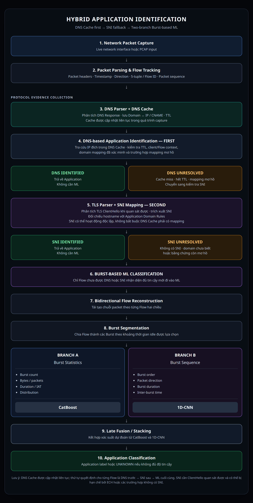

# Hybrid Application Identification — Tài liệu dự án

> Đọc file này trước. Kiến trúc runtime chuẩn được định nghĩa trong `edge-ai-project-docs/01-system-architecture.md` và phải tuân theo sơ đồ Hybrid Application Identification.

## 1. Dự án là gì?

Dự án nhận diện ứng dụng tạo ra lưu lượng mạng từ metadata và hành vi packet/flow, không giải mã payload ứng dụng. Runtime ưu tiên nhận diện bằng DNS, dùng TLS SNI làm fallback, rồi mới dùng mô hình Burst-based ML cho Flow chưa được nhận diện.

## 2. Mục tiêu

- Nhận packet từ interface mạng hoặc file PCAP.
- Parse packet và theo dõi Flow.
- Cập nhật DNS Cache từ DNS Response quan sát được.
- Nhận diện ứng dụng theo thứ tự DNS → SNI → Burst-based ML.
- Dùng CatBoost cho Burst Statistics và 1D-CNN cho Burst Sequence.
- Hợp nhất hai nhánh ML bằng Late Fusion / Stacking.
- Trả application label hoặc `UNKNOWN`, kèm evidence và confidence nếu có.

## 3. Runtime flow — thứ tự bắt buộc

1. Network Packet Capture.
2. Packet Parsing & Flow Tracking.
3. DNS Parser + DNS Cache.
4. DNS-based Application Identification — FIRST.
   - `DNS_IDENTIFIED`: trả Application và kết thúc nhận diện cho Flow đó.
   - `DNS_UNRESOLVED`: chuyển sang bước 5.
5. TLS Parser + SNI Mapping — SECOND.
   - `SNI_IDENTIFIED`: trả Application và kết thúc nhận diện cho Flow đó.
   - `SNI_UNRESOLVED`: chuyển sang bước 6.
6. Burst-based ML Classification.
7. Bidirectional Flow Reconstruction.
8. Burst Segmentation.
9. Hai nhánh song song:
   - Branch A: Burst Statistics → CatBoost.
   - Branch B: Burst Sequence → 1D-CNN.
10. Late Fusion / Stacking.
11. Application Classification: application label hoặc `UNKNOWN`.



Số thứ tự trên bám theo các khối trong sơ đồ. Bước 6 là nhánh ML; bước 7–10 mô tả cách nhánh ML tạo và hợp nhất dự đoán. Không đảo thứ tự DNS và SNI. Không đưa Flow đã được DNS/SNI nhận diện vào ML.

## 4. Công nghệ có bằng chứng trong snapshot hiện tại

| Thành phần | Công nghệ / bằng chứng |
|---|---|
| Packet capture | Scapy; `requirements.txt` khai báo `scapy>=2.5.0` |
| Rule configuration | YAML; `PyYAML` |
| TLS parsing support | `cryptography` được khai báo |
| CLI/output | Rich được khai báo |
| Test | pytest được khai báo |
| ML code trong snapshot | `ml/train_flow.py`, `ml/train_device.py`, `ml/evaluate.py`, `ml/predictor.py` |
| Model labels | `ml/models/flow/label_encoder.json`, `ml/models/device/label_encoder.json` |

**Chưa được xác nhận từ snapshot:** thư viện/framework triển khai CatBoost, 1D-CNN, runtime SNI mapping, bidirectional reconstruction, burst segmentation và Late Fusion. Không tự thêm dependency hoặc giả định implementation đã tồn tại.

## 5. Bản đồ tài liệu

| File | Vai trò |
|---|---|
| [00-project-overview.md](edge-ai-project-docs/00-project-overview.md) | Bài toán, phạm vi, đối tượng và kết quả |
| [01-system-architecture.md](edge-ai-project-docs/01-system-architecture.md) | Flow chuẩn, nhánh quyết định và ranh giới module |
| [02-runtime-packet-flow.md](edge-ai-project-docs/02-runtime-packet-flow.md) | Capture, parse, điều phối packet và Flow |
| [03-dns-cache-design.md](edge-ai-project-docs/03-dns-cache-design.md) | DNS parser, cache, TTL và điều kiện DNS identified |
| [04-flow-tracking.md](edge-ai-project-docs/04-flow-tracking.md) | Flow key, direction, lifecycle và packet sequence |
| [05-burst-based-approach.md](edge-ai-project-docs/05-burst-based-approach.md) | Bidirectional reconstruction, segmentation và hai nhánh ML |
| [06-data-collection-and-labeling.md](edge-ai-project-docs/06-data-collection-and-labeling.md) | PCAP, session, nhãn và dataset |
| [07-feature-engineering.md](edge-ai-project-docs/07-feature-engineering.md) | Burst Statistics, Burst Sequence và feature contract |
| [08-model-training-and-evaluation.md](edge-ai-project-docs/08-model-training-and-evaluation.md) | Huấn luyện, fusion, calibration và metrics |
| [09-runtime-classification.md](edge-ai-project-docs/09-runtime-classification.md) | DNS → SNI → ML và kết quả cuối |
| [10-testing-and-troubleshooting.md](edge-ai-project-docs/10-testing-and-troubleshooting.md) | Test theo module và end-to-end |
| [11-roadmap-and-status.md](edge-ai-project-docs/11-roadmap-and-status.md) | Trạng thái, việc cần làm và DoD |
| [12-glossary-and-decisions.md](edge-ai-project-docs/12-glossary-and-decisions.md) | Từ điển và quyết định kiến trúc |

## 6. Cách cài đặt và chạy

Snapshot hiện có `requirements.txt`, nhưng chưa cung cấp một entrypoint runtime thống nhất có thể xác nhận từ tài liệu. Cài dependency trong môi trường ảo:

```bash
python3 -m venv .venv
source .venv/bin/activate
pip install -r requirements.txt
```

Chạy lệnh runtime chỉ sau khi xác minh entrypoint thật trong repository. Không tự suy ra lệnh chạy từ tên module tài liệu.

## 7. Quy ước trạng thái

- **Implemented:** Có code và đường gọi thực tế.
- **Tested:** Có test tự động hoặc test PCAP chứng minh.
- **Designed:** Có trong kiến trúc/tài liệu nhưng chưa xác nhận implementation.
- **Open:** Còn thiếu quyết định hoặc thông số.

Không mô tả `Designed` như chức năng đã hoàn thành.
