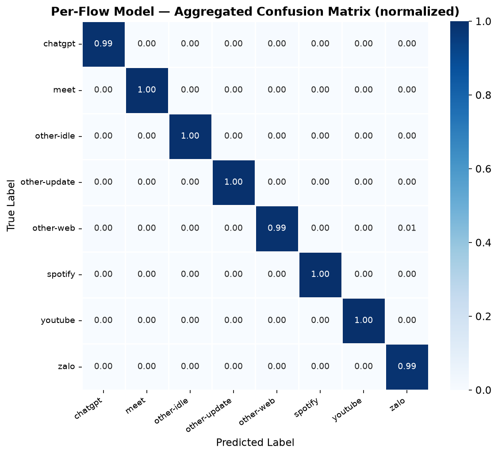
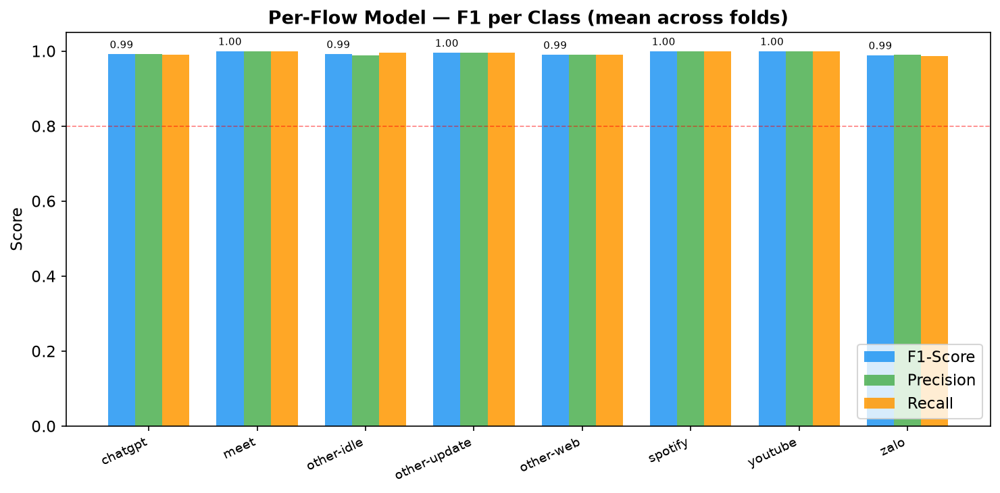
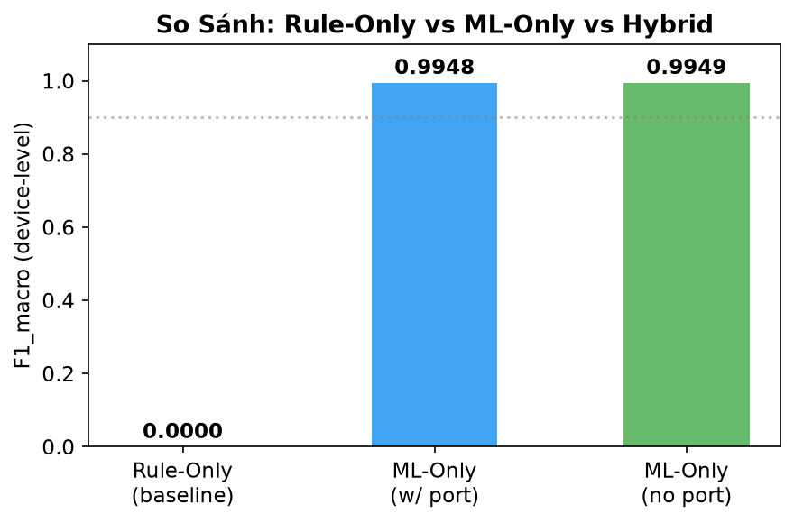

<div align="center">

# 🔍 Edge AI — Phân Loại Ứng Dụng Qua Lưu Lượng Mạng Mã Hóa

**Đồ án Tốt nghiệp Đại học**

[](https://python.org)
[](https://lightgbm.readthedocs.io)
[](LICENSE)

**Nhóm thực hiện:** Trần Văn Danh &nbsp;·&nbsp; Lê Nhựt Phương

</div>

---

## 📖 Đề tài là gì?

> Xây dựng hệ thống **Edge AI** có khả năng nhận biết ứng dụng nào đang chạy trên từng thiết bị trong mạng LAN — **chỉ dựa vào metadata gói tin, không giải mã nội dung**.

Ví dụ thực tế khi hệ thống chạy:

```
[192.168.1.10 | AA:BB:CC:11:22:33]  →  YouTube   (conf: 0.97)  [rule/sni]
[192.168.1.15 | AA:BB:CC:44:55:66]  →  Spotify   (conf: 0.99)  [ml]
[192.168.1.22 | AA:BB:CC:77:88:99]  →  ChatGPT   (conf: 0.95)  [rule/sni]
[192.168.1.30 | AA:BB:CC:AA:BB:CC]  →  Zalo      (conf: 0.93)  [ml]
```

---

## ❓ Vấn đề cần giải quyết

Ngày nay hơn **90% lưu lượng Internet sử dụng TLS 1.3 hoặc QUIC** — payload hoàn toàn mã hóa, các công cụ truyền thống như DPI (Deep Packet Inspection) không thể nhận biết ứng dụng nữa.

| Phương pháp | Hoạt động được với TLS 1.3? | Ghi chú |
|-------------|---------------------------|---------|
| DPI (kiểm tra payload) | ❌ | Nội dung bị mã hóa |
| Port-based | ⚠️ Rất hạn chế | Hầu hết dùng port 443 |
| **Phương pháp này (metadata + AI)** | ✅ | Không cần giải mã |

**Giải pháp:** Phân tích các thông tin *không bị mã hóa* (kích thước gói, thời gian, hướng, SNI, fingerprint TLS) kết hợp AI để nhận diện ứng dụng.

---

## 🏗️ Kiến trúc hệ thống

```
                    ┌─────────────────────────────────┐
                    │        PACKET CAPTURE           │
                    │   (Scapy / tcpdump live/pcap)   │
                    └────────────────┬────────────────┘
                                     │ Raw packets
                    ┌────────────────▼────────────────┐
                    │       FLOW TRACKER              │
                    │  Ghom gói tin → Flow 5-tuple    │
                    │  Trích xuất: SNI, JA3/JA4, DNS  │
                    └────────────────┬────────────────┘
                                     │ Flow info + Stats
                    ┌────────────────▼────────────────┐
                    │     HYBRID CLASSIFIER           │
                    │                                 │
                    │  ┌───────────────────────────┐  │
                    │  │   RULE ENGINE (5 lớp)     │  │
                    │  │  L1: SNI/Domain matching  │  │
                    │  │  L2: DNS correlation      │  │
                    │  │  L3: JA3/JA4 fingerprint  │  │
                    │  │  L4: Port/Protocol        │  │
                    │  │  L5: IP/ASN lookup        │  │
                    │  └──────────┬────────────────┘  │
                    │    conf≥0.7 │  conf<0.7          │
                    │             │      │             │
                    │             │  ┌───▼──────────┐ │
                    │             │  │  ML FALLBACK │ │
                    │             │  │  LightGBM    │ │
                    │             │  │  F1 = 0.995  │ │
                    │             │  └───────────────┘│
                    └────────────────┬────────────────┘
                                     │ (app, confidence, source)
                    ┌────────────────▼────────────────┐
                    │   DEVICE ACTIVITY AGGREGATOR    │
                    │  Vote theo bytes — window 30s   │
                    │  "Máy X → YouTube (dominant)"  │
                    └────────────────┬────────────────┘
                                     │
                    ┌────────────────▼────────────────┐
                    │         DASHBOARD / UI          │
                    │  Real-time per-device display   │
                    └─────────────────────────────────┘
```

---

## 🔧 Quy trình hoàn chỉnh

### Bước 1 — Thu thập dữ liệu

```
Raspberry Pi (đặt trong mạng)
    │
    ├── Wireshark / tcpdump → file .pcap
    └── Ghi nhãn thủ công: START/END từng app
```

Sử dụng `tools/capture_session.py` để tự động hóa quá trình này — script hướng dẫn người dùng mở từng ứng dụng và gắn nhãn thời gian tự động.

### Bước 2 — Xây dựng Dataset

```
file .pcap + labels.jsonl
        │
        ▼ ml/dataset_builder.py
        │
        ├── dataset_flow.csv    → 9,383 mẫu (window 5 giây / flow)
        ├── dataset_device.csv  → 2,290 mẫu (window 30 giây / device)
        └── meta.json           → thông tin dataset
```

Mỗi mẫu gồm **24 đặc trưng** thống kê không cần giải mã:

| Nhóm | Đặc trưng |
|------|-----------|
| Đếm gói | `n_pkts_total`, `n_pkts_fwd`, `n_pkts_bwd` |
| Kích thước | `pkt_len_mean`, `pkt_len_std`, `pkt_len_min`, `pkt_len_max` |
| Bytes | `bytes_total`, `bytes_fwd`, `bytes_bwd`, `bytes_ratio` |
| Thời gian giữa gói (IAT) | `iat_mean`, `iat_std`, `iat_min`, `iat_max` |
| Tốc độ | `fwd_pkt_per_sec`, `bwd_pkt_per_sec` |
| Giao thức | `dest_port`, `is_tcp`, `is_udp` |

### Bước 3 — Huấn luyện mô hình AI

**Chiến lược đánh giá:** Leave-One-Session-Out (LOSO) Cross Validation — 5 fold, mỗi fold dùng 1 batch làm test, 4 batch còn lại làm train. Đảm bảo không rò rỉ dữ liệu giữa train/test.

```
5 batch dữ liệu
│
├── Fold 1: Train[2,3,4,5] → Test[1]
├── Fold 2: Train[1,3,4,5] → Test[2]
├── Fold 3: Train[1,2,4,5] → Test[3]
├── Fold 4: Train[1,2,3,5] → Test[4]
└── Fold 5: Train[1,2,3,4] → Test[5]
           └── Tổng hợp kết quả → F1 mean ± std
```

### Bước 4 — Phân loại thời gian thực

```
Packet đến → Flow Tracker → Rule Engine
                                  │
                              conf ≥ 0.7?
                             YES ──────────────────► kết quả
                              NO
                               │
                           LightGBM predict
                               │
                           conf ≥ 0.5?
                             YES ──────────────────► kết quả
                              NO ──────────────────► "unknown"
```

---

## 📊 Kết quả thực nghiệm

### Model 1 — LightGBM Per-Flow (window 5 giây)

| Metric | Giá trị |
|--------|---------|
| **F1 Macro (mean)** | **0.9948** |
| F1 Std | ± 0.0013 |
| F1 Min | 0.9930 |
| F1 Max | 0.9965 |
| Số mẫu test/fold | ~1,875 |

### Model 2 — LightGBM Per-Device (window 30 giây)

| Metric | Giá trị |
|--------|---------|
| **F1 Macro (mean)** | **0.9974** |
| F1 Std | ± 0.0022 |
| F1 Min | 0.9933 |
| F1 Max | 1.0000 |

### Chi tiết Per-Class (Flow Model, fold tốt nhất)

| App | Precision | Recall | F1 |
|-----|:---------:|:------:|:--:|
| youtube | 0.989 | 0.989 | 0.989 |
| spotify | 1.000 | 1.000 | 1.000 |
| meet | 1.000 | 1.000 | 1.000 |
| zalo | 0.992 | 0.985 | 0.989 |
| chatgpt | 0.989 | 0.989 | 0.989 |
| other-idle | 0.988 | 1.000 | 0.994 |
| other-update | 1.000 | 0.993 | 0.996 |
| other-web | 1.000 | 0.979 | 0.990 |

> Xem biểu đồ đầy đủ tại [`ml/results/report.html`](ml/results/report.html)

---

## 📂 Cấu trúc thư mục

```
.
├── 📄 rule_engine.py          # ⭐ Rule Engine đa lớp (SNI/DNS/JA3/JA4/Port/ASN)
├── 📄 rules.yaml              # Bộ quy tắc: domain patterns, JA3/JA4, port, IP/ASN
├── 📄 example.py              # Demo script minh họa Rule Engine
├── 📄 requirements.txt        # Python dependencies
│
├── 📁 ml/                     # Module AI/ML
│   ├── 📄 __init__.py
│   ├── 📄 dataset_builder.py  # PCAP + labels → CSV dataset
│   ├── 📄 features.py         # WindowStats, extract_flow_features, DeviceWindowCollector
│   ├── 📄 gen_synthetic.py    # Sinh dữ liệu tổng hợp (không cần Pi)
│   ├── 📄 train_flow.py       # Train LightGBM per-flow với LOSO CV
│   ├── 📄 train_device.py     # Train LightGBM per-device với LOSO CV
│   ├── 📄 train_ts.py         # Train 1D-CNN/LSTM → export ONNX
│   ├── 📄 predictor.py        # ⭐ Inference: FlowPredictor + DeviceWindowPredictor
│   ├── 📄 evaluate.py         # Sinh báo cáo, confusion matrix, F1 charts
│   │
│   ├── 📁 data/               # Dataset files (không push .csv lớn lên GitHub)
│   │   └── 📄 meta.json       # Metadata: batch IDs, class names, sample counts
│   │
│   ├── 📁 models/             # Trained models
│   │   ├── 📁 flow/           # LightGBM flow models + calibrators
│   │   └── 📁 device/         # LightGBM device models + calibrators
│   │
│   ├── 📁 results/            # Biểu đồ đánh giá
│   │   ├── 🖼️ flow_confusion_matrix.png
│   │   ├── 🖼️ flow_f1_per_class.png
│   │   ├── 🖼️ device_confusion_matrix.png
│   │   ├── 🖼️ ablation_comparison.png
│   │   └── 📄 report.html
│   │
│   └── 📁 tests/
│       └── 📄 test_features.py
│
├── 📁 tools/
│   ├── 📄 capture_session.py  # Thu thập traffic có gắn nhãn trên Raspberry Pi
│   └── 📄 PI_SETUP.md         # Hướng dẫn cài đặt môi trường Raspberry Pi
│
├── 📄 test_rule_engine.py     # Test suite cho Rule Engine
├── 📄 test_ml_dataset_builder.py
└── 📄 verify_layer1_rules.py  # Kiểm tra tính nhất quán của rules.yaml
```

---

## ⚙️ Cài đặt

### Yêu cầu
- Python **3.9+**
- Linux (Raspberry Pi OS / Ubuntu / Debian)
- Quyền `sudo` để sniff packets live

### 1. Clone repo

```bash
git clone https://github.com/nhutphuongasasa/DO-AN-TOT-.git
cd DO-AN-TOT-
```

### 2. Tạo môi trường ảo và cài dependencies

```bash
python3 -m venv .venv
source .venv/bin/activate

# Dependencies cơ bản (Rule Engine + capture)
pip install -r requirements.txt

# Dependencies cho ML training
pip install lightgbm scikit-learn pandas matplotlib seaborn

# Dependencies cho CNN/LSTM (tùy chọn)
pip install torch onnx onnxruntime
```

---

## 🚀 Hướng dẫn sử dụng

### Demo Rule Engine (không cần model)

```bash
python3 example.py
```

### Thu thập traffic thực (cần Raspberry Pi hoặc máy trong mạng)

```bash
# Chạy với sudo — hướng dẫn interactive từng bước
sudo python3 tools/capture_session.py \
    --batch batch1 \
    --iface wlan0 \
    --dur 30
# Output: captures/batch1/*.pcap + labels*.jsonl + session*.json
```

### Sinh dữ liệu tổng hợp (không cần Pi)

```bash
python3 -m ml.gen_synthetic --out-dir captures/ --batches 5
```

### Xây dựng dataset từ captures

```bash
python3 -m ml.dataset_builder \
    --sessions captures/ \
    --out ml/data/
# Output: ml/data/dataset_flow.csv, dataset_device.csv, meta.json
```

### Huấn luyện mô hình

```bash
# Model 1: LightGBM per-flow (5 giây / flow)
python3 -m ml.train_flow

# Model 2: LightGBM per-device (30 giây / device)
python3 -m ml.train_device

# Model 3: 1D-CNN time-series (cần PyTorch)
python3 -m ml.train_ts
```

### Sinh báo cáo đánh giá

```bash
python3 -m ml.evaluate \
    --flow-results ml/models/flow/cv_summary.json \
    --device-results ml/models/device/cv_summary.json \
    --out ml/results/

# Mở báo cáo HTML
xdg-open ml/results/report.html
```

### Chạy test suite

```bash
pytest test_rule_engine.py -v          # ~200 test cases
pytest test_ml_dataset_builder.py -v
python3 verify_layer1_rules.py         # Kiểm tra rules.yaml
```

---

## 🧠 Giải thích Rule Engine (5 lớp)

Rule Engine phân loại theo nguyên tắc ưu tiên lớp — lớp có độ tin cậy cao hơn sẽ ghi đè lớp thấp hơn:

| Lớp | Nguồn | Độ ưu tiên | Độ tin cậy điển hình |
|-----|-------|:----------:|:--------------------:|
| L1: SNI | TLS ClientHello / QUIC Initial | 1 (cao nhất) | 0.90–0.95 |
| L2: DNS | DNS cache (IP ↔ Domain) | 2 | 0.75–0.85 |
| L3: JA3/JA4 | TLS fingerprint | 3 | 0.70–0.80 |
| L4: Port | Destination port + protocol | 4 | 0.50–0.65 |
| L5: IP/ASN | IP range / ASN lookup | 5 (thấp nhất) | 0.40–0.55 |

Khi có xung đột giữa các lớp → lấy lớp ưu tiên cao hơn và giảm confidence theo `conflict_penalty`.

Khi Rule Engine không đủ tin cậy (`confidence < 0.70`) → **fallback sang LightGBM ML**.

---

## 📈 Biểu đồ kết quả

| Confusion Matrix (Flow) | F1 Per Class | Ablation Study |
|:-----------------------:|:------------:|:--------------:|
|  |  |  |

---

## 🗺️ Roadmap

- [x] Rule Engine 5 lớp (SNI/DNS/JA3/JA4/Port/ASN)
- [x] Dataset Builder (PCAP → CSV)
- [x] Feature Engineering (WindowStats, DeviceWindowCollector)
- [x] LightGBM training + LOSO CV
- [x] Isotonic calibration
- [x] Ablation study (so sánh có/không port features)
- [x] Evaluation report (HTML + biểu đồ)
- [x] Capture tool cho Raspberry Pi
- [ ] 🔧 Hybrid pipeline tích hợp Rule Engine + ML
- [ ] 🖥️ Dashboard UI (real-time per-device display)

---

## 👥 Nhóm thực hiện

| Thành viên | Vai trò |
|------------|---------|
| Trần Văn Danh | ... |
| Lê Nhựt Phương | ... |

---

## 📚 Tài liệu tham khảo

- [LightGBM Documentation](https://lightgbm.readthedocs.io)
- [Scapy Documentation](https://scapy.readthedocs.io)
- IETF RFC 8446 — TLS 1.3
- IETF RFC 9000 — QUIC

---

<div align="center">

*Đồ án Tốt nghiệp — Khoa Công nghệ Thông tin*

</div>
